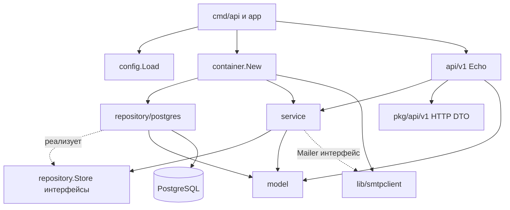

# Архитектура backend TourneyHub

Backend разделён по ответственности: HTTP API преобразует запрос/ответ, сервис выполняет бизнес-сценарий, репозиторий хранит данные. Такое направление соответствует подходу [Aiinnur/transportgate](https://github.com/Aiinnur/transportgate), который использован как образец организации Go-кода. TourneyHub сохраняет собственные доменные правила, Echo, pgx, goose и PostgreSQL; инфраструктура, зависимости внешних сервисов и предметные сущности transportgate сюда не переносились.

## Границы слоёв

Стрелка от сервиса к repository означает зависимость от интерфейса хранения. Прикладные SQL-запросы и объекты драйвера находятся в адаптере `repository/postgres`; отдельный инфраструктурный пакет `migration` запускает SQL-миграции через goose. В runtime контейнер связывает сервис с PostgreSQL-реализацией; в unit-тесте вместо неё передаётся fake Store.

На HTTP-границе также заданы небольшие интерфейсы: `service.Identity`, `Teams`, `Tournaments`, `Competition`, `Admin`, `Catalog`, `Resources`. Конструктор API принимает их объединение `service.Backend` и сохраняет соответствующие зависимости; `*service.Service` является одной реализацией этих интерфейсов. Поэтому транспорт можно проверять без привязки к конкретной реализации сервиса.

| Пакет | Что делает | Что остаётся за его границей |
| --- | --- | --- |
| `internal/api/v1` | Echo routes/middleware, валидация HTTP-контракта, bind JSON/multipart, явные DTO ↔ model преобразования, status/envelope, Blob/CSV/SSE transport | SQL, курсоры, транзакционные объекты, принятие бизнес-решений |
| `internal/service` | Роли и отношение к объекту, версии, сроки, регламент, составы и состояния; координация алгоритмов и репозиториев; границы бизнес-транзакций; worker | Echo/OpenAPI DTO, pgx, SQL, чтение ENV |
| `internal/repository` | Типизированные интерфейсы `Identity`, `Teams`, `Tournaments`, `Competition`, `Ancillary`, `Common`; Store и `WithinTx`; параметры/результаты хранения | Реализация запросов и типы конкретного драйвера |
| `internal/repository/postgres` | SQL, блокировки, pgx, материализация строк в модели, преобразование ошибок БД, begin/commit/rollback | Формирование HTTP-ответов и правила разрешённости пользовательского действия |
| `internal/model` | Собственные типы входных/выходных значений сценариев, Principal, алгоритмы сеток/серий/Эло | Импорты Echo, OpenAPI runtime и PostgreSQL-драйвера |
| `internal/lib` | Небольшие общие средства, используемые несколькими сценариями | Управление турниром или работа с HTTP-контекстом |
| `internal/config` | YAML, ENV-переопределения, defaults и проверка конфигурации | Бизнес-сценарии и динамическое чтение параметров в обработчиках |
| `internal/container` | Создание пула, PostgreSQL-репозитория, SMTP-клиента и сервиса из Config | Правила регистрации, команд, турниров и результатов |
| `internal/app` | Запуск Echo/worker, сигналы и graceful shutdown | SQL и обработка предметных состояний |

`model` и HTTP DTO могут иметь похожие поля, но являются отдельными Go-типами. `internal/api/v1/mapping.gen.go` содержит типизированные преобразования, включая вложенные поля, указатели, enum и массивы; сервис не делает JSON round-trip для приведения DTO. `make generate` пересоздаёт маршруты/HTTP DTO и mapping; `make generate-check` обнаруживает рассинхронизацию сохранённых результатов генерации.

## Общие библиотеки

| Пакет `internal/lib` | Назначение |
| --- | --- |
| `authctx` | Principal в `context.Context`, текущий пользователь и проверка ролей |
| `apperror` | Ошибка приложения с Kind, безопасным Message и исходной Cause; не зависит от HTTP |
| `security` | Генерация/хеширование секретных токенов, bcrypt и ограничения пароля |
| `pagination` | Одинаковые значения limit/offset |
| `ptr`, `slice` | Типизированные преобразования указателей и последовательностей на границе DTO |
| `csvutil` | Экранирование значений, похожих на формулы при импорте CSV |
| `fileutil` | Проверка содержимого и имени файла без Echo/multipart |
| `smtpclient` | SMTP-адаптер с переданной конфигурацией, STARTTLS, таймаутами и отменой context |

Транспорт извлекает IP login из TCP-запроса и передаёт его сервису как значение. Проверенная учётная запись помещается в context через `authctx`. Сервисы получают такие данные явно и не читают заголовки/тело HTTP-запроса.

## Сборка зависимостей и конфигурация

1. `cmd/api` вызывает `config.Load`. Значения по умолчанию дополняются YAML и ENV, затем проверяются.
2. `app.Run` передаёт готовый Config в `container.New`.
3. Контейнер создаёт `pgxpool.Pool`, проверяет соединение, оборачивает его в `postgres.New(pool)` и передаёт полученный `repository.Store` в `service.New`.
4. Если `cfg.SMTP.Address` заполнен, создаётся `smtpclient.New(cfg.SMTP)` как реализация `service.Mailer`; иначе очередь писем остаётся до настройки доставки.
5. `api.NewServer` получает сервис через `service.Backend` и `cfg.HTTP`. Health/readiness использует маленький интерфейс `Ping(context.Context) error`; пул не передаётся бизнес-обработчикам.
6. Worker использует тот же сервис и срок жизни приложения. При остановке отменяется его context, затем завершаются сервер и зависимости.

Чтение ENV сосредоточено в `internal/config`. Сервис хранит полученный `cfg`, SMTP-клиент — `config.SMTP`; изменение `PUBLIC_WEB_URL` или таймаутов процесса после создания зависимостей не меняет поведение уже созданного сервиса. Требуется перезапуск.

В `config/config.yaml` выделены `http`, `public`, `smtp`, `worker`, `database`, `migrations`. Секреты DB/SMTP и `ADMIN_*` приходят через ENV. В [README backend](../backend/README.md#конфигурация) приведены реальные имена ENV и значения таймаутов. `config.LoadBootstrap` отдельно проверяет настройки CLI администратора, который также вызывает сервис через DI-контейнер.

## Пример подачи заявки в одной транзакции

Сценарий `POST /api/v1/tournaments/{id}/applications` показывает место каждой ответственности:

1. HTTP middleware проверяет Bearer-токен через сервис, помещает Principal в context и проверяет параметры/тело по OpenAPI. `api.SubmitApplication` связывает HTTP DTO, преобразует его в `model.ApplicationRequest` и вызывает `service.SubmitApplication`.
2. Сервис открывает `Store.WithinTx` через `s.withTx`. Callback получает Store, все методы которого обращаются к одной SQL-транзакции. Сервис не получает `pgx.Tx` и не передаёт строки SQL.
3. `ReadTournament(..., true)` в PostgreSQL-адаптере выполняет `FOR UPDATE OF t`. Под этой блокировкой сервис проверяет статус и время регистрации, видимость и вместимость.
4. Сервис читает сохранённые ограничения состава. Для индивидуальной заявки использует/создаёт personal team; для команды проверяет капитана и активное членство игроков. Репозиторий выполняет нужные SELECT/блокировки и возвращает типизированные результаты проверок.
5. Через `CreateApplicationRecord` и `ReserveApplicationPlayers` записываются заявка, исторический снимок игроков и reservation. PK `(tournament_id,user_id)` не допускает второй активной заявки этого игрока за другую команду.
6. В той же транзакции увеличивается версия турнира, записываются аудит, событие, личное уведомление и SMTP outbox. Доставка по сети здесь не выполняется.
7. Ошибка проверки, SQL-ограничения или записи приводит к rollback всей операции. При успехе PostgreSQL-адаптер делает commit, сервис возвращает `model.Application`, API преобразует её в HTTP DTO и отвечает 201.

Блокировка турнира сериализует принятие заявок и проверку вместимости. Метод API не может обойти этот порядок прямым UPDATE: у него нет зависимости от PostgreSQL. Конфликт версии — ошибка приложения, которую HTTP-слой отображает как 409 с общим envelope.

Фиксация результата матча организована аналогично: сервис координирует матч, продвижение по сетке, таблицу, Эло, места, аудит, уведомления и события, передавая всем операциям один transaction Store. SMTP worker работает позже со своей транзакцией outbox и `SKIP LOCKED`; сбой после отправки DATA и до commit может привести к повторной доставке.

## Проверки границ и поведения

- `internal/service/*_test.go`: чистые проверки регламента и политики, а также сценарии с небольшими fake-репозиториями. Примеры: публикация турнира и отказ без записей при stale version/чужом владельце, сброс пароля, подтверждение результата другой стороной.
- `internal/lib/*/*_test.go`: алгоритмы работы с токенами/паролями, файлы, CSV, SMTP-кодирование, конфигурация и отмена соединения.
- `internal/api/v1/*_integration_test.go`: реальные HTTP-запросы проходят через API, сервис и PostgreSQL-репозиторий. Ответы сверяются с OpenAPI; fixtures создают отдельные схемы. Сохранены проверки объектов, версий, форматов турниров и конкурентных действий.
- `internal/architecture/architecture_test.go`: Go AST-тесты отслеживают запрещённые зависимости, SQL/прямой доступ к данным вне адаптера и ENV-чтение вне `config`. Они дополняют поведенческие тесты; успешная проверка импортов сама по себе не доказывает корректность бизнес-транзакции.

Команды: `make check build docs`, а для выделенной пустой тестовой БД — `TEST_DATABASE_URL=... make integration-test`. Точные результаты, число тестов и метрики следует брать из соответствующего сохранённого запуска. Переезд файла между слоями сам по себе не является доказательством улучшения сложности: для ЛР3 сравниваются зафиксированные исходники с описанным scope.
